## Overview

::: {.process-row}
1. `ABCCT`<br>The battery, its tasks, and its findings
2. `Equipment`<br>What we ship; what sites buy
3. `A session`<br>The GUI, step by step
4. `Saved data`<br>Files, upload, checks, cleaning
5. `Sharing`<br>Kit, updates, and checklist
:::

::: {.notes}
Timing: 0:45 (cumulative 1:05). First, the ABCCT battery that ARIA-ET implements and what it showed. Then the equipment each site gets, and a walk through one session in the GUI. Then what ARIA-ET saves and how it protects the data. Last, how we keep the sites the same: software updates, the checks on each uploaded session, and preprocessing.
:::

# ABCCT

## ABCCT

**A**utism **B**iomarkers **C**onsortium for **C**linical **T**rials

::: {.columns .compact-bullets}
::: {.column width="50%"}
**The consortium**

- Five US sites
- autistic and typically developing youth
  - 6-11 years of age.
  - IQ 60–150 (typical: 80–150)
:::
::: {.column width="50%"}
**The tasks**

- 4 tasks, 2 constructs:
  - social attention: gaze to faces (3 tasks)
  - autonomic function: pupil light reflex (1 task) 
:::
:::

::: {.notes}
Timing: 1:00 (cumulative 2:05). ABCCT is the Autism Biomarkers Consortium for Clinical Trials, funded by NIMH (U19 MH108206, PI McPartland). Its question: can a lab measure such as eye tracking or EEG serve as an objective outcome in autism clinical trials? The study was observational and ran at five sites: Yale, UCLA, Boston Children's Hospital / Harvard, University of Washington, and Duke. Each visit took two days, and the eye-tracking battery ran on both days. The age range was narrow to limit developmental variability and to make data collection likely to succeed. Exclusions in both groups: genetic or neurological conditions, and sensory problems that would stop the protocol.
:::

## Activity Monitoring

::: {.image-text-slide}

::: {.image-panel}
{muted="" fig-alt="Five seconds of an Activity Monitoring video: two women sit on a rug and play with toys."}
:::

::: {.text-panel}
- Two adults play with toys
- 8 video trials and 8 image trials
- The actors look at the activity or at each other
- Measure: gaze to faces vs. the activity
:::

:::

::: {.notes}
Timing: 0:40 (cumulative 2:45). Five seconds of one trial. A video trial is 18 to 22 seconds; an image trial is 10 seconds with the task soundtrack. In half the trials the actors look at the shared activity, and in the other half they look at each other.
:::

## Static Social Scenes

::: {.result-comparison-slide}

::: {.result-panel}
**Static scene**

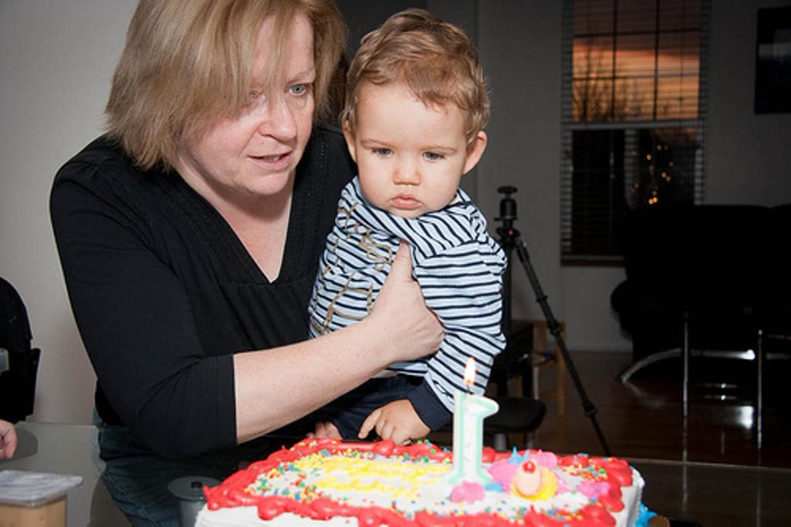{fig-alt="Static scene stimulus: a woman holds a toddler in front of a birthday cake."}
:::

::: {.result-panel}
**Visual search**

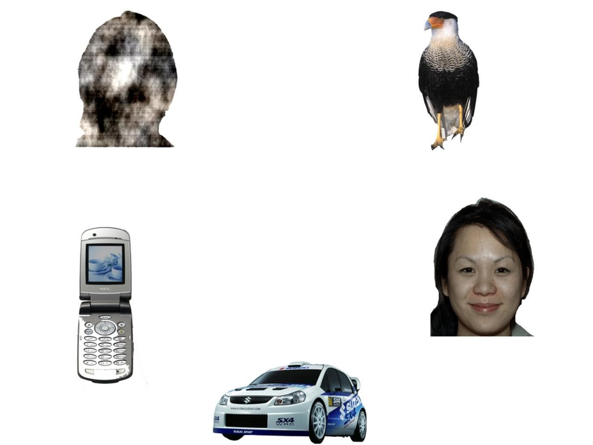{fig-alt="Visual search stimulus: a face among objects such as a phone, a car, and a bird on a white background."}
:::

:::

- 12 trials; the two trial types alternate

::: {.notes}
Timing: 0:40 (cumulative 3:25). Static scenes show people in everyday scenes on a black background. Visual search shows one face among objects on a white background, and asks how fast and how often the child finds the face.
:::

## Social Interactive

::: {.image-text-slide}

::: {.image-panel}
{fig-alt="Five seconds of a Social Interactive video: a boy and a girl sit on a mat and play with cards."}
:::

::: {.text-panel}
- Two children play
- 22 video trials:
  - 11 parallel play
  - 11 cooperative play
- Measure: gaze to faces
:::

:::

::: {.notes}
Timing: 0:40 (cumulative 4:05). Five seconds of one trial. In parallel play the children play next to each other; in cooperative play they play together. This is the longest task, at 6 minutes.
:::

## Pupillary Light Reflex

::: {.image-text-slide}

::: {.image-panel}
{fig-alt="Five seconds of a Pupillary Light Reflex trial: a small fixation stimulus on a black screen, then a short white flash."}
:::

::: {.text-panel}
- Small attention stimulus on a black screen
- A white flash of 4 frames
- 18 trials, 6.2 s each
- Measure: pupil constriction and its latency
:::

:::

::: {.notes}
Timing: 0:40 (cumulative 4:45). The flash comes at about 2.7 seconds in this clip. The pupil response depends on the screen brightness and the room light, which is why we are matching the ABCCT illuminance on our monitor (issue 94) and writing a room-light procedure (issue 97).
:::

## ABCCT Eyetracking findings

::: {.compact-bullets}
- **OMI**: Oculomotor Index of Gaze to Human Faces
- Mean % of looking time on faces in Activity Monitoring, Social Interactive, and Static Social Scenes
- In autism: higher OMI goes with fewer symptoms and higher verbal IQ (small effects)
- Accepted into the FDA Biomarker Qualification Program
:::

::: {.source-line}
Shic et al. (2022), *Molecular Autism*. 280 autistic and 119 typically developing children.
:::

::: {.notes}
Timing: 1:15 (cumulative 6:00). Shic and colleagues tested the five eye-tracking tasks against five biomarker properties: acquisition rate, construct validity, six-week stability, group discrimination, and relation to clinical measures. The OMI was defined in advance: it is the equal-weight average of the percent of looking time on faces in the three social tasks, chosen because those variables loaded together in the feasibility study. Valid data exceeded 95 % in both groups. The OMI was stable from baseline to six weeks (ICC 0.84 autism, 0.83 typical). Autistic children looked at faces less: 24.4 % versus 30.9 % (d = 0.79), and the difference held after control for age, IQ, data quality, and site. Associations with clinical measures were small, so the OMI is not a proxy for symptoms; it measures attention to faces with precision. A Letter of Intent for the OMI was accepted by the FDA CDER Biomarker Qualification Program. Biological Motion was the weakest task and was later dropped from the battery. Because this battery is validated, we want our data to be comparable to ABCCT data.
:::

## How We Differ From ABCCT

::: {.compact-table}

| | ABCCT | ARIA-ET |
|:--|:--|:--|
| Tracker | EyeLink 1000 Plus, 500 Hz | Tobii Pro Spectrum |
| Tasks | AM, SI, SS, **Biological Motion**, PLR | AM, SI, SS, PLR |
| Task order | Tasks interleaved | One run per task |
| Trials split across 2 days/sessions | 1 session |
:::

::: {.notes}
Timing: 1:30 (cumulative 7:30). These are decisions that affect comparability with ABCCT data. Biological Motion was removed from the ABCCT battery in MOP version 5. The task order is the largest difference: ABCCT interleaved blocks from different tasks to reduce fatigue. We run each task as a separate run. If the study needs a fixed or counterbalanced order, we set it in the protocol, not in the software.
:::

## The ARIA Eyetracking Battery

::: {.compact-table}

| Task | Trials | Duration | Measures |
|:--|--:|--:|:--|
| Activity Monitoring | 16 | 4.7 min | Gaze to faces vs. the shared activity |
| Static Social Scenes | 12 | 3.5 min | Gaze to people in scenes; visual search |
| Social Interactive | 22 | 6.0 min | Gaze to faces in parallel and cooperative play |
| Pupillary Light Reflex | 18 | 1.9 min | Pupil constriction after a light flash |
| **Total** | **68** | **16.1 min** | |

:::

::: {.source-line}
Duration is the nominal stimulus time. It does not include calibration, positioning, or breaks. Preview videos: User guide, Task reference.
:::

::: {.notes}
Timing: 0:45 (cumulative 8:15). The first three tasks make up the OMI. PLR measures the autonomic response. Each task page in the docs has a preview video, so you can see the stimuli before a session. Plan for more than 16 minutes in the room: calibration, positioning before each task, and breaks add time.
:::


# Equipment

## What Each Site Uses

::: {.columns}
::: {.column width="50%"}
** We buy and ship**

-  Acquisition laptop, with ARIA-ET installed
-  Light meter
:::
::: {.column width="50%"}
** The site buys**

-  Tobii Pro Spectrum eye tracker
:::
:::

::: {.notes}
Timing: 0:30 (cumulative 8:45). We buy the laptop and the light meter centrally, set them up, and ship them, so each site has the same software and measures the light the same way. The site buys its own Tobii Pro Spectrum. Later in the talk we come back to how updates and data move between the sites and us.
:::

# A Session, Start To Finish

## Five Steps In The GUI

::: {.process-row}
1. `Setup`<br>Open the session
2. `Hardware`<br>Check the tracker
3. `Calibration`<br>Calibrate and validate
4. `Battery`<br>Run the four tasks
5. `Export`<br>Write BIDS files
:::

::: {.notes}
Timing: 0:45 (cumulative 9:30). The sidebar follows the order of a session. Each page gets a check mark when it is complete. The next slides go through each step.
:::

## Step 1: Setup

::: {.gui-shot}
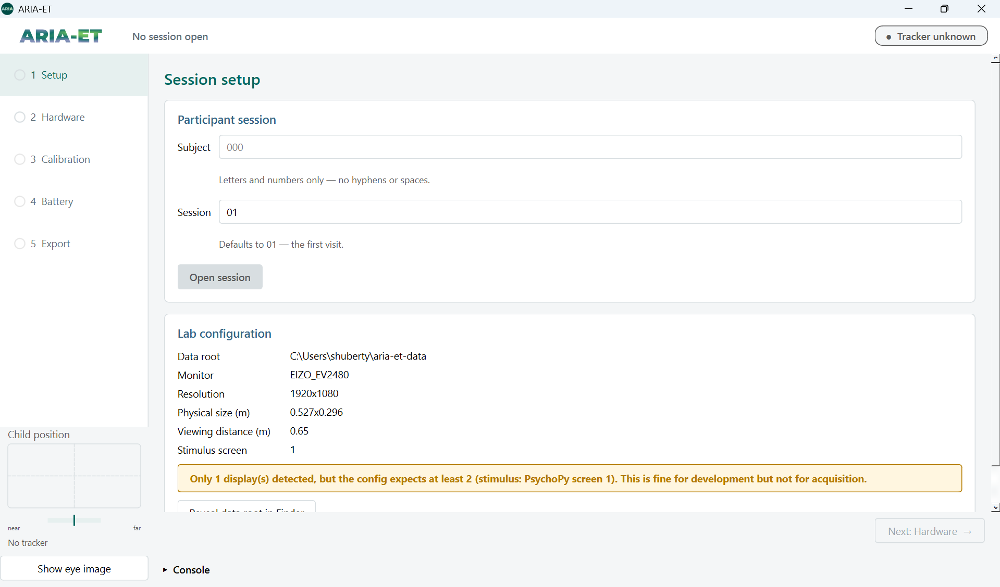{fig-alt="ARIA-ET Setup page: Subject and Session fields, the Open session button, and the Lab configuration card with a warning that only 1 display was detected."}
:::

::: {.gui-caption}
Type the subject and session, click **Open session**, and check **Lab configuration**.
:::

::: {.notes}
Timing: 0:30 (cumulative 10:00). The sidebar lists the five steps in order. Here the laptop has only one display, so the Lab configuration card shows a warning. With this warning, do not collect data.
:::

## 1. Setup: Open A Session

::: {.image-text-slide}

::: {.image-panel}
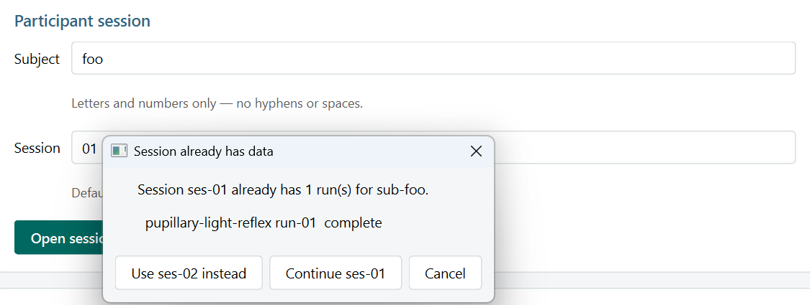{fig-alt="Dialog Session already has data, with the buttons Use ses-02 instead, Continue ses-01, and Cancel."}
:::

::: {.text-panel}
- Subject: letters and numbers only
- Session: `01` for the first visit
- Existing data? Choose the next session or continue
- Check the **Lab configuration** card
  - a display warning means: do not collect
:::

:::

::: {.notes}
Timing: 1:00 (cumulative 11:00). Labels become BIDS file names, so the page refuses hyphens and spaces; Fix labels removes them. If the session already has runs, the GUI asks if you want the next free session or to add runs to this one. ARIA-ET never overwrites a run.
:::

## Step 2: Hardware

::: {.gui-shot}
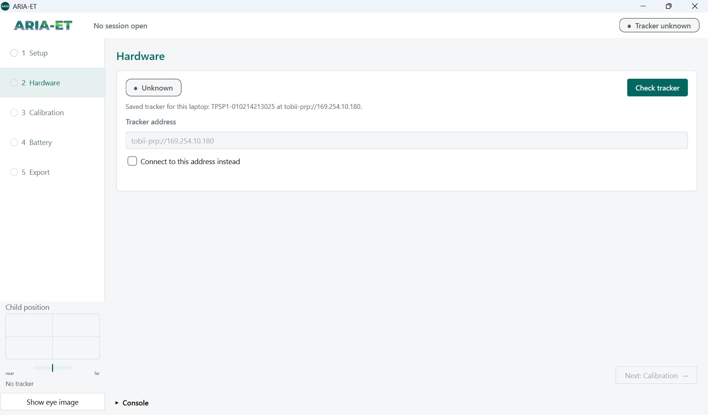{fig-alt="ARIA-ET Hardware page: tracker status Unknown, the saved tracker for this laptop, the tracker address, and the Check tracker button."}
:::

::: {.gui-caption}
Click **Check tracker**. The GUI connects to the tracker that is saved for this laptop.
:::

::: {.notes}
Timing: 0:30 (cumulative 11:30). The page shows the serial number and the address of the saved tracker. Use Connect to this address instead only if the central team tells you to.
:::

## 2. Hardware: Check The Tracker

::: {.image-text-slide}

::: {.image-panel}
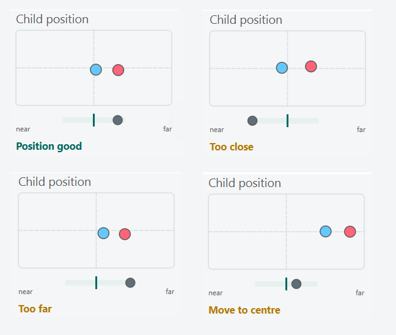{fig-alt="Four Child position panels with the status Position good, Too close, Too far, and Move to centre."}
:::

::: {.text-panel}
- Click **Check tracker**; the status shows **Connected**
- The **Child position** panel stays live on every page
  - Position good, Too close, Too far, Move to centre
- It shows where the eyes are, not where the child looks
:::

:::

::: {.notes}
Timing: 1:00 (cumulative 12:30). The GUI saves the tracker for the laptop. The Child position panel reads the tracker's user position stream during calibration and during runs. Use it to see if the child slides down or leans forward during a task. The distance thresholds are first estimates; tell me if they do not match what you see in the room.
:::

## When The Tracker Cannot Find The Eyes

::: {.image-text-slide}

::: {.image-panel}
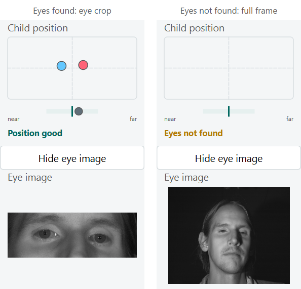{fig-alt="Two Eye image panels. On the left, the tracker finds the eyes. On the right, the status is Eyes not found and the image shows the full face."}
:::

::: {.text-panel}
- Click **Show eye image**
- Look for the cause:
  - glasses reflections
  - eyelids, hair, a hand
- Nothing is saved
:::

:::

::: {.notes}
Timing: 0:45 (cumulative 13:15). When the tracker finds the eyes, the image shows only the eyes. When it does not, it shows the camera frame with the face. This is new in 0.1.2. The images are not recorded and do not change the recording.
:::

## Step 3: Calibration

::: {.gui-shot}
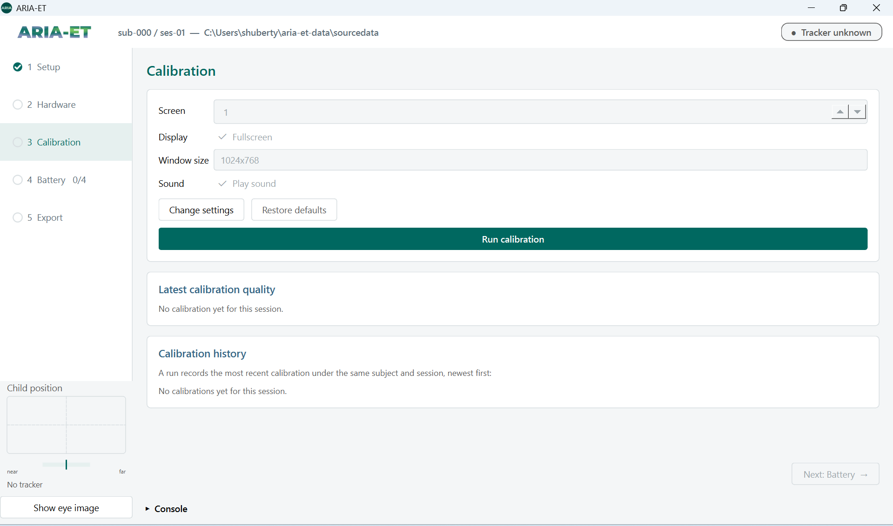{fig-alt="ARIA-ET Calibration page: locked calibration settings, the Run calibration button, and empty Latest calibration quality and Calibration history cards."}
:::

::: {.gui-caption}
Keep the default settings and click **Run calibration**.
:::

::: {.notes}
Timing: 0:30 (cumulative 13:45). The header now shows the open session. The settings are locked; Restore defaults puts them back if someone changed them. The Latest calibration quality and Calibration history cards fill after each calibration.
:::

## 3. Calibration

::: {.image-text-slide}

::: {.image-panel}
{muted="" fig-alt="Simulated 5-point DeToX calibration: an animated animal target appears at the centre and at each corner, then the results screen shows the gaze samples near each target."}
:::

::: {.text-panel}
- Animated targets with sound
- 5 points: four corners and the centre
- **Number key**: show a target
- **Space**: collect gaze when the child looks
- **Enter**: compute, then accept
:::

:::

::: {.notes}
Timing: 0:45 (cumulative 14:30). This clip is a simulation with a scripted mouse in place of the eyes, so the gaze points on the results screen are orange; with a child they are blue and pink for each eye. The sound loops while a target shows and fades out when you press Space. The pauses while DeToX collects gaze are shortened in this clip. If some points are poor, press their number keys and Space to collect them again.
:::

## Validation

::: {.image-text-slide}

::: {.image-panel}
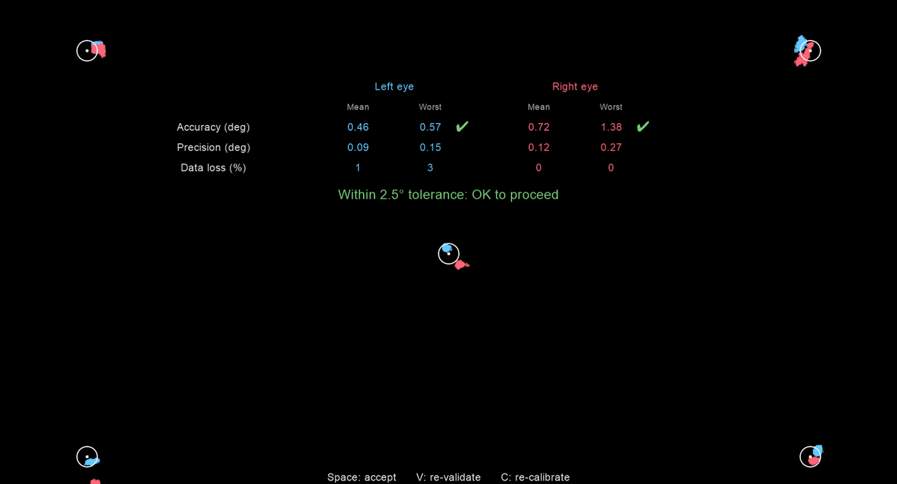{fig-alt="Validation results on the stimulus screen. The gaze of each eye is near each target, and the verdict is Within 2.5 degree tolerance: OK to proceed."}
:::

::: {.text-panel}
- After you accept: one target per point
- Press **Space** when the child looks
- Table: accuracy, precision, data loss for each eye
:::

:::

::: {.notes}
Timing: 0:45 (cumulative 15:15). After you accept, ARIA-ET shows validation targets in random order and measures how far the gaze is from each one. The blue and pink points are the left and right eye.
:::

## The 2.5° Rule

::: {.image-text-slide}

::: {.image-panel}
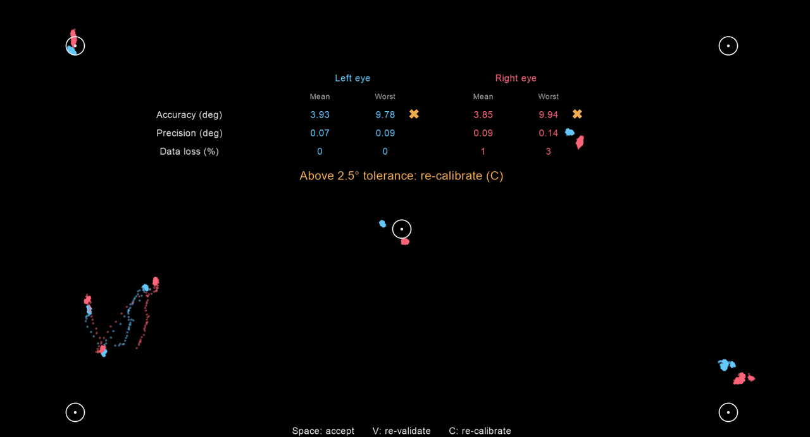{fig-alt="Validation results with gaze far from three corner targets, and the verdict Above 2.5 degree tolerance: re-calibrate (C)."}
:::

::: {.text-panel}
- Pass: **one eye** has **every target** within 2.5°
- The worst target counts, not the mean
- Above tolerance: press **C** and calibrate again
- Accuracy usually gets worse during a session
:::

:::

::: {.notes}
Timing: 1:15 (cumulative 16:30). The 2.5 degree value comes from ABCCT. ABCCT applied it to the mean error of each trial. We apply it to the worst target, right after calibration, which is stricter. A mean of 1.3 degrees can hide a corner at 3.1 degrees, and the corners matter because the stimuli fill the screen. Since accuracy drifts during a session, treat the rule as a minimum.
:::

## Step 4: Battery

::: {.gui-shot}
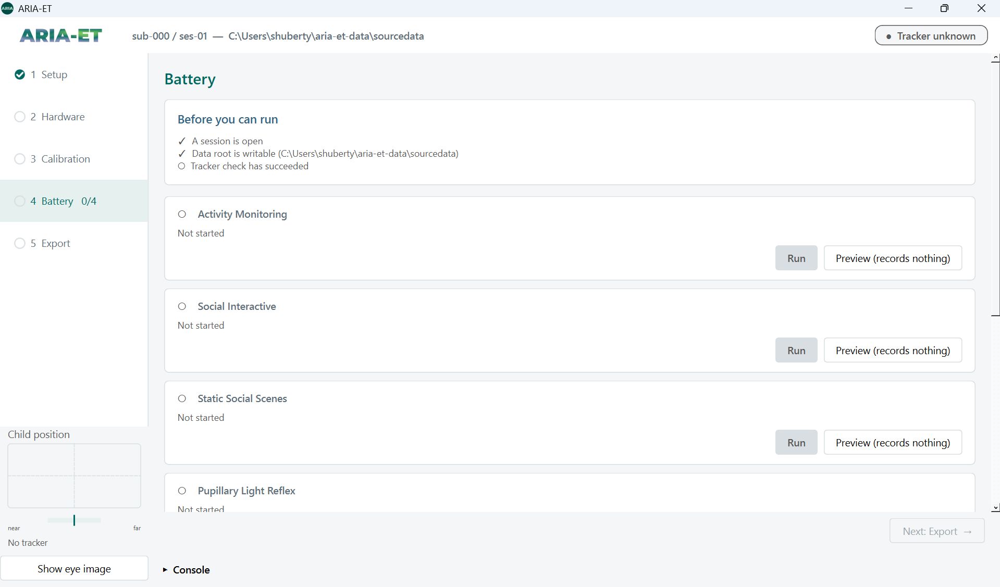{fig-alt="ARIA-ET Battery page: the Before you can run checklist and one card for each task with Run and Preview buttons."}
:::

::: {.gui-caption}
**Before you can run** needs three check marks. Then click **Run** on a task card.
:::

::: {.notes}
Timing: 0:30 (cumulative 17:00). In this screenshot the tracker check has not succeeded yet, so one item has no check mark. Preview shows a task without the tracker and records nothing. Each task has its own card.
:::

## 4. Battery: Position, Then Run

::: {.image-text-slide}

::: {.image-panel}
{fig-alt="Five seconds of the positioning screen in simulation: the distance marker moves from far to the centre of the bar, and the two eye dots move to the edge of the track box and back, above an animated video of animals."}
:::

::: {.text-panel}
- **Before you can run** has three check marks
- **Presentation** settings are the defaults
- Click **Run** on a task card
- Press **Space** when the child is in position
:::

:::

::: {.notes}
Timing: 1:00 (cumulative 18:00). Each task starts with this positioning screen. This clip is a simulation: the eyes start too far, come to the good distance, drift to the side, and come back to the centre. The black marker on the green bar is the distance; the dots in the box are the eyes. The video holds the child's attention while you adjust the chair. The task starts only when you press Space, and only after the first gaze sample arrives. If you see "Custom presentation settings are in use", click Restore defaults before you collect data.
:::

## Monitor Each Run

::: {.wide-figure}
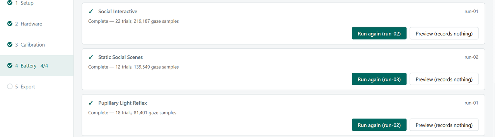{fig-alt="Battery page with complete task cards, Run again buttons, and the sidebar item Battery 4/4."}
:::

- Each card shows trials done and trials left
- End states: **Complete**, **Incomplete**, **Failed**, **Stopped by operator**
- A warning appears if gaze samples were dropped

::: {.notes}
Timing: 1:15 (cumulative 19:15). A complete card shows the number of trials and gaze samples. If a run is incomplete or failed, the panel "Last run needs attention" shows the end of the log. In a normal run, dropped samples are 0 and you see no warning. If you see the warning, write it in the session notes.
:::

## Trial Progress And Dropped Samples

::: {.stacked-figures}
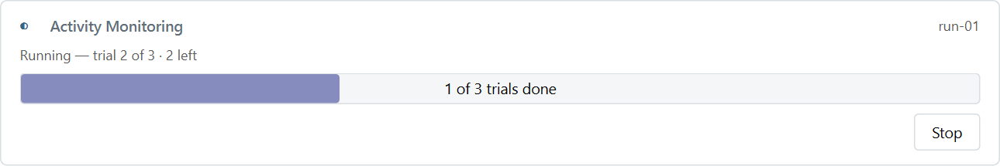{fig-alt="Activity Monitoring dry run: trial 2 of 3, 2 left, 1 of 3 trials done."}

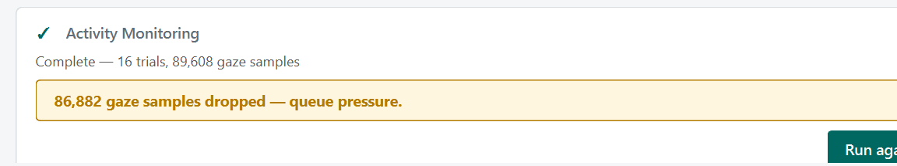{fig-alt="Activity Monitoring task card with a warning banner that gives the number of dropped gaze samples."}
:::

# What Gets Saved

## Data Folders

```text
aria-et-data\
├── sourcedata\                         raw data, never overwritten
│   └── sub-01\ses-01\
│       ├── calibrations\calibration-<time>\
│       └── task-ActivityMonitoring_run-01\
│           ├── gaze.jsonl              one line per gaze sample
│           ├── eye_openness.jsonl      eyelid opening, in mm
│           ├── events.jsonl            trials and stimuli
│           ├── session.json            task, tracker, calibration in effect
│           ├── gaze_writer.json        received, written, dropped samples
│           ├── tracker.json            serial number, firmware, screen geometry
│           ├── sys_info.json           software versions
│           └── session.log             task output with time stamps
└── bids\
    └── sub-01\ses-01\beh\              events.tsv, eye1 / eye2 physio.tsv.gz
```

::: {.notes}
Timing: 1:15 (cumulative 20:30). Two trees. sourcedata is the raw record and is the copy to back up. bids is the analysis copy, made from sourcedata. Each run folder says which calibration was in effect, which tracker and firmware recorded it, and which software version ran. The BIDS physio sidecars contain the calibration error.
:::

## Upload To LASSO

::: {.process-row .three-steps}
1. `Export`<br>Export the session to BIDS in the GUI
2. `Upload`<br>Upload the session folder (raw runs and BIDS) to LASSO
3. `Check`<br>We check each uploaded session
:::

::: {.notes}
Timing: 0:30 (cumulative 21:00). After each session the site exports it in the GUI and uploads the whole session folder to LASSO: the raw runs and the BIDS export. We need the raw runs, because the checks on the next slide read session.json, the events, and the writer counts.
:::

## Checks On Each Uploaded Session

::: {.compact-table}

| Check | What we compare | FAIL when |
|:--|:--|:--|
| Run metadata | system settings at runtime | A value differs |
| Trial count | Trials vs. the task specification | A count differs |
| Missing data | Gaps in the gaze; both eyes valid (reported) | > 0.5 % lost |
:::

::: {.source-line}
Each check reports FAIL, WARN, or INFO for each run. Script: `tools/validate_session.py`.
:::

::: {.notes}
Timing: 1:00 (cumulative 22:00). We run the same validation script on each uploaded session. It compares the run files with what the task specification expects: the right task, all trials, the right mix of trial types, a calibration on record, and the same screen geometry as at calibration. It confirms that each gaze sample the tracker sent is on disk, that the rate is 600 Hz, and that the gaze covers the whole task. Missing data is measured as samples lost in gaps of the gaze time stamps, which fails above 0.5 %; any gap is a warning. The share of samples with both eyes valid is reported, not judged, because it depends on the child. Finally it checks that the BIDS files match the raw data and runs the BIDS validator. Today the script expects one complete run of each task; a session with a stopped run or a second run gets a FAIL on the run count and we review it by hand.
:::

## Preprocessing With eyeQuality

::: {.process-row}
1. `Clean`<br>Remove invalid and offscreen gaze
2. `Interpolate`<br>Fill short gaps
3. `Blinks`<br>Find blinks in the pupil data
4. `Select, smooth`<br>Combine the eyes; smooth
5. `Classify`<br>Fixations and saccades ([I-VT]{style="white-space: nowrap"})
:::

::: {.compact-bullets}
- `eyeQuality`: an R package for preprocessing and data quality, maintained by our study colleague Jed Ellison
- Output: preprocessed gaze, pupil, and distance; quality metrics; standard plots
- Next: a reader for ARIA-ET BIDS files
:::

::: {.notes}
Timing: 0:45 (cumulative 22:45). After the checks, the data go through eyeQuality, an R package for transparent and reproducible eye-tracking preprocessing. The steps run in this order: invalid and offscreen gaze are removed, short gaps are interpolated, blinks are found with a noise-based method (Hershman, Henik, and Cohen, 2018), the two eyes are combined and smoothed, and the velocity is used for an I-VT classification of fixations and saccades. Each file also gets summary quality metrics and three standard plots. Today eyeQuality reads Tobii Studio and Tobii Pro Lab exports, so it needs a reader for the ARIA-ET BIDS files before our data can go through it.
:::

# Sharing the equipment with you.

## From Central Team To Site

::: {.distribution-diagram}

::: {.dist-head}
 Central team
:::

::: {.dist-gap}
:::

::: {.dist-head}
 Site
:::

::: {.dist-gap}
:::

::: {.dist-head}
 LASSO
:::

::: {.dist-box}
**Set up the kit**

Buy the laptop and the light meter. Install the ARIA-ET release and the Tobii software. Configure and sign off.
:::

::: {.dist-arrow}
<br>Ship the kit
:::

::: {.dist-box}
**Receive the kit**

 Acquisition laptop<br> Light meter
:::

::: {.dist-gap}
:::

::: {.dist-gap}
:::

::: {.dist-box}
**New release**

A signed installer for each update.
:::

::: {.dist-arrow}
<br>Walk-through call
:::

::: {.dist-box}
**Install the update**

With IT on the call.
:::

::: {.dist-gap}
:::

::: {.dist-gap}
:::

::: {.dist-gap}
:::

::: {.dist-gap}
:::

::: {.dist-box}
**Record and export**

Each session, to BIDS.
:::

::: {.dist-arrow}
<br>Upload
:::

::: {.dist-box}
**Study data**

The raw runs and the BIDS export of each session.
:::

:::

::: {.notes}
Timing: 1:15 (cumulative 24:00). The central team buys the acquisition laptop and the light meter, installs the ARIA-ET release with the Tobii software, configures the laptop, and does the hardware sign-off before it ships. Thus each site starts with the same software, the same configuration, and the same light meter. The site does not install software on its own: for each update, IT meets a site team member on a call and walks them through the installation. After each session, the site uploads the session folder, with the raw runs and the BIDS export, to LASSO. We need the raw runs for the data checks. The site supplies the tracker and the stimulus monitor.
:::

## Software Updates

::: {.process-row}
1. `Release`<br>We publish a signed installer
2. `Call`<br>IT meets a site team member
3. `Install`<br>The new version, next to the old one
4. `Check`<br>Open it; run `aria-et sys-info`
5. `Remove`<br>Uninstall the old version
:::

::: {.guarantee}
 **The same software on every laptop.** A lock file (`pixi.lock`) pins the exact version and build of every package: PsychoPy, the Tobii SDK, DeToX, and the movie decoder. Each installer contains exactly these packages.
:::

- One release for a full study wave; never update during a session

::: {.notes}
Timing: 1:00 (cumulative 25:00). The current release is 0.1.2. Two laptops with the same release have the same packages, down to the build, so a difference between sites cannot come from the software. The laptop needs no Python and no internet connection for the installation. Three components are outside the lock: Tobii Eye Tracker Manager, Tobii Pro Network Runtime, and the tracker firmware. Each run records their versions in sys_info.json, and IT checks them on the call with sys-info. The new version installs next to the old one, so the site can go back if the new version does not open.
:::

## Status And Next Steps

- Receive laptops for each site, install software, run checks.
- check stimuli onset precision with a photodiode
- Ship laptops to sites

::: {.notes}
Timing: 1:00 (cumulative 27:00). Until ABCCT gives permission, the installer and stimuli stay in the lab. The PsychoPy upgrade changes how movies are decoded, so we will re-qualify the stimuli before we release it. Send problems with the run folder and session.log; those two things let me find most causes.
:::

## Questions?

::: {.notes}
Timing: 0:30 (cumulative 27:30).
:::

# Backup

## Calibration Metrics {#backup-calibration}

- **Accuracy**: median angle between gaze and target, in degrees
- **Precision**: RMS of sample-to-sample angles (RMS-S2S)
- **Data loss**: percentage of samples without valid gaze
- Same method as Titta
- BIDS: `AverageCalibrationError`, `MaximalCalibrationError`

::: {.notes}
Backup. Values are reported per eye, as the mean over targets and the worst target. Precision, data loss, and mean accuracy are for information only; only the worst-target accuracy decides the verdict. The threshold is ACCURACY_TOLERANCE_DEG in aria_et/calibration.py.
:::

## The Calibration Card In The GUI {#backup-calibration-card}

::: {.wide-figure}
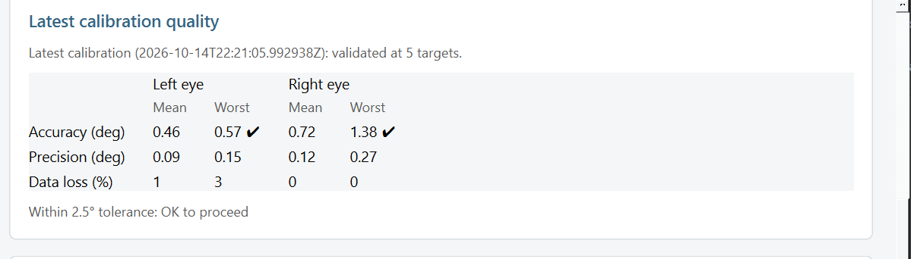{fig-alt="Latest calibration quality card. The worst accuracy of each eye has a check mark, and the verdict is Within 2.5 degree tolerance: OK to proceed."}
:::

- The Calibration page shows the same table as the stimulus screen
- **Calibration history** lists each calibration of the session

## Eye Tracker Manager Calibration {#backup-etm}

- The GUI always runs the child-friendly calibration
- For a standard Tobii calibration, use the **ARIA-ET Prompt**:

```bat
aria-et calibrate-eyetracker --routine etm --subject <label> --session <label>
```

- Do not calibrate in Eye Tracker Manager directly: ARIA-ET does not record it

## References {#backup-references}

::: {.source-line}

Shic, F., Naples, A. J., Barney, E. C., et al. (2022). The Autism Biomarkers Consortium for Clinical Trials: evaluation of a battery of candidate eye-tracking biomarkers for use in autism clinical trials. *Molecular Autism, 13*, 15.

Webb, S. J., Shic, F., Murias, M., et al. (2020). Biomarker acquisition and quality control for multi-site studies: the Autism Biomarkers Consortium for Clinical Trials. *Frontiers in Integrative Neuroscience, 13*, 71. doi:10.3389/fnint.2019.00071

Shic, F., Naples, A., Barney, E., et al. (2022). ABC-CT Data Acquisition and Analytic Core ET Main Study Manual of Operations, Version 5.1.

:::
